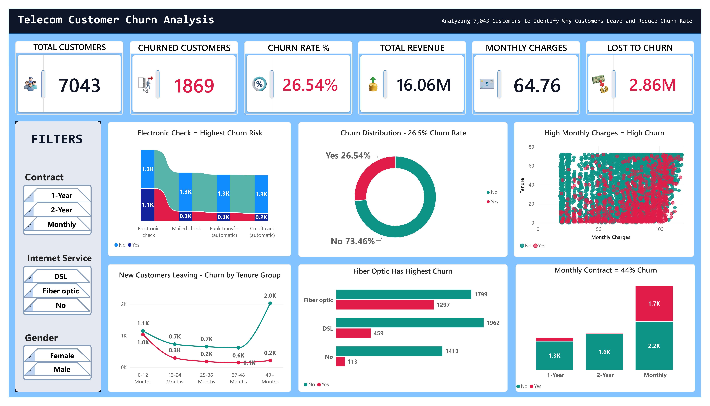

# 📡 Telecom Customer Churn Analysis — SQL Server & Power BI

## 📌 Project Overview
**End-to-end churn analysis of the data of 7,043 telecom customers** — from SQL Server cleaning and KPI logic to an interactive Power BI dashboard, uncovering exactly which customers are leaving, which payment/contract patterns drive it, and how much revenue is at stake.

## The Analysis Covers:
- [Business Problem](#business-problem)
- [Dataset Overview](#dataset-overview)
- [Tech Stack](#tech-stack)
- [What This Project Does](#what-this-project-does)
- [Key Insights](#key-insights)
- [My Process](#my-process)
- [SQL Queries](#sql-queries)
- [DAX Measures](#dax-measures)
- [Repository Structure](#repository-structure)
- [How to Run](#how-to-run)
- [Skills Demonstrated](#skills-demonstrated)
- [Results & Conclusion](#results-conclusion)
- [Author](#author)

---
<br>

[](https://www.linkedin.com/in/hafiz-arslan-shafique-bc240203664/)
[](https://github.com/Hafiz-Arslan-Shafique)
[](https://mail.google.com/mail/?view=cm&fs=1&to=hafizarslan3195@gmail.com)
[](tel:+966579594038)



---

<a id="business-problem"></a>
## 🧩 Business Problem
A telecom provider is losing roughly a quarter of its customer base, and every churned customer takes recurring revenue with them. **The business needs to know which contract types, payment methods, internet services, and tenure stages carry the highest churn risk** — so retention campaigns and pricing/contract incentives can be aimed at the segments actually driving the loss, instead of being applied uniformly across all 7,043 customers.

---

<a id="dataset-overview"></a>
## 🗂️ Dataset Overview
The dataset contains **7,043 telecom customers** with demographic, account, and service attributes, including:
- Customer ID, gender, senior-citizen status, partner/dependents status
- Tenure (months with the company)
- Phone, internet, and add-on services (multiple lines, online security/backup, device protection, tech support, streaming TV/movies)
- Contract type, paperless billing, payment method
- Monthly charges and total charges
- **Churn** — the target field indicating whether the customer left

---

<a id="tech-stack"></a>
## 🧰 Tech Stack
- **SQL Server (T-SQL)** — schema design, data cleaning, validation, and churn/revenue analysis
- **Power BI** — interactive dashboard design and visualization
- **DAX** — KPI and measure calculations
- **Power Query** — data shaping and preparation for Power BI
- **GitHub** — version control and portfolio hosting

---

<a id="what-this-project-does"></a>
## 🎯 What This Project Does
Every churned telecom customer represents lost recurring revenue that's far more expensive to win back than to retain. I analyzed **the data of 7,043 telecom customers** using **SQL Server** to clean the raw records and calculate churn/revenue KPIs, then built an **interactive Power BI dashboard** so stakeholders can filter by contract, internet service, and gender to explore exactly where churn concentrates.

| | |
|---|---|
| **Customers Covered (data records)** | 7,043 |
| **Churned Customers** | 1,869 |
| **Churn Rate** | 26.54% |
| **Total Revenue** | 16.06M |
| **Avg Monthly Charges** | 64.76 |
| **Revenue Lost to Churn** | 2.86M |
| **Tools** | SQL Server, T-SQL, Power BI, DAX, Power Query |

---

<a id="key-insights"></a>
## 💡 Key Insights
- **Fiber optic customers churn at the highest rate of any internet-service group** — 1,297 of 3,096 fiber customers (≈41.9%) churned, compared with roughly 19% for DSL and 7.4% for customers with no internet service.
- **Electronic check is the highest-risk payment method** — the dashboard's flow chart flags it as the single biggest source of churned customers among all payment methods (mailed check, bank transfer, credit card).
- **Month-to-month contracts drive the bulk of churn** — the dashboard shows roughly 44% churn on monthly contracts, far above the 1-year and 2-year contract segments, making contract length one of the strongest churn predictors in the data.
- **Churn is concentrated in the first year of tenure** — customers in the 0–12 month band churn at a much higher relative rate than long-tenure customers; by 49+ months, retained customers vastly outnumber churned ones.
- **Higher monthly charges correlate with higher churn**, especially combined with short tenure — visible directly in the tenure-vs-monthly-charges scatter plot.
- **Churn is already costing the business 2.86M** in lost revenue against 16.06M in total revenue generated — a meaningful share of the customer base.

---

<a id="my-process"></a>
## 🛠️ My Process
1. **Set up the schema and loaded the raw data** — created `dbo.TelcoChurn` in SQL Server with all 21 source fields, and added a compatibility view (`[Telecom Churn & Revenue]`) so the analysis queries could run against a business-friendly name without changing any logic.
2. **Validated and cleaned the data** — checked for NULLs in key fields, replaced missing `TotalCharges` values, trimmed whitespace from text columns, and checked for duplicate `customerID`s and unexpected category values.
3. **Calculated the core churn KPIs** — total customers, churned vs. retained counts, churn rate percentage, total revenue, and average monthly charge.
4. **Segmented churn across the customer profile** — gender, senior-citizen status, contract type, internet service, payment method, and tenure.
5. **Quantified the revenue impact of churn** — split total revenue into revenue retained vs. revenue lost to churned customers.
6. **Modeled and visualized results in Power BI**, turning the SQL findings into KPI cards, a payment-method flow chart, a churn-by-tenure trend, and service/contract breakdowns for a non-technical, business-ready dashboard.

<a id="sql-queries"></a>
<details>
<summary><b>📂 See full SQL queries with explanations</b></summary>

### 1. Database and table setup
```sql
CREATE DATABASE TelecomChurnDB;
GO
USE TelecomChurnDB;
GO

CREATE TABLE dbo.TelcoChurn (
    customerID VARCHAR(20) PRIMARY KEY,
    gender VARCHAR(10),
    SeniorCitizen INT,
    Partner VARCHAR(10),
    Dependents VARCHAR(10),
    tenure INT,
    PhoneService VARCHAR(20),
    MultipleLines VARCHAR(25),
    InternetService VARCHAR(20),
    OnlineSecurity VARCHAR(25),
    OnlineBackup VARCHAR(25),
    DeviceProtection VARCHAR(25),
    TechSupport VARCHAR(25),
    StreamingTV VARCHAR(25),
    StreamingMovies VARCHAR(25),
    Contract VARCHAR(30),
    PaperlessBilling VARCHAR(10),
    PaymentMethod VARCHAR(50),
    MonthlyCharges DECIMAL(10,2),
    TotalCharges DECIMAL(10,2),
    Churn VARCHAR(10)
);
```
**Purpose:** Creates the database and the raw customer table with all 21 source fields, matching the original Telco churn dataset schema.

### 2. Compatibility view for business-friendly naming
```sql
CREATE VIEW dbo.[Telecom Churn & Revenue]
AS
SELECT * FROM dbo.TelcoChurn;
```
**Purpose:** Lets every downstream query reference a readable business name (`[Telecom Churn & Revenue]`) while the physical table stays `dbo.TelcoChurn` — a packaging fix, not additional business logic.

### 3. NULL / blank check
```sql
SELECT
    COUNT(*) AS TotalRows,
    SUM(CASE WHEN customerID IS NULL THEN 1 ELSE 0 END) AS Null_customerID,
    SUM(CASE WHEN TotalCharges IS NULL THEN 1 ELSE 0 END) AS Null_TotalCharges,
    SUM(CASE WHEN MultipleLines IS NULL THEN 1 ELSE 0 END) AS Null_MultipleLines
FROM dbo.[Telecom Churn & Revenue];
```
**Purpose:** Confirms data completeness on the fields most likely to break downstream aggregation, before any cleaning is applied.

### 4. Data cleaning — missing values and whitespace
```sql
UPDATE dbo.[Telecom Churn & Revenue]
SET TotalCharges = 0
WHERE TotalCharges IS NULL;

UPDATE dbo.[Telecom Churn & Revenue]
SET
    Partner = LTRIM(RTRIM(Partner)),
    Dependents = LTRIM(RTRIM(Dependents)),
    PhoneService = LTRIM(RTRIM(PhoneService)),
    Churn = LTRIM(RTRIM(Churn));
```
**Purpose:** Replaces missing `TotalCharges` with 0 and trims stray whitespace from key categorical fields so grouping and filtering behave correctly.

### 5. Duplicate customer check
```sql
SELECT customerID, COUNT(*) AS DuplicateCount
FROM dbo.[Telecom Churn & Revenue]
GROUP BY customerID
HAVING COUNT(*) > 1;
```
**Purpose:** Verifies `customerID` is unique, protecting every KPI and segment calculation from duplicate-driven inflation.

### 6. Distinct-value validation
```sql
SELECT DISTINCT gender FROM dbo.[Telecom Churn & Revenue];
SELECT DISTINCT Contract FROM dbo.[Telecom Churn & Revenue];
SELECT DISTINCT InternetService FROM dbo.[Telecom Churn & Revenue];
SELECT DISTINCT Churn FROM dbo.[Telecom Churn & Revenue];
```
**Purpose:** Confirms categorical fields only contain expected values before they're used as dashboard filters and slicers.

### 7. Main KPI calculation
```sql
SELECT
    COUNT(*) AS Total_Customers,
    SUM(CASE WHEN Churn = 'Yes' THEN 1 ELSE 0 END) AS Total_Churned,
    CAST(
        SUM(CASE WHEN Churn = 'Yes' THEN 1 ELSE 0 END) * 100.0
        / COUNT(*) AS DECIMAL(10,2)
    ) AS Churn_Rate_Percent,
    SUM(TotalCharges) AS Total_Revenue,
    AVG(MonthlyCharges) AS Avg_Monthly_Charge
FROM dbo.[Telecom Churn & Revenue];
```
**Purpose:** Calculates the five headline numbers that power the dashboard's KPI cards in one pass.

### 8. Churn by demographics and contract
```sql
SELECT gender, COUNT(*) AS Total,
       SUM(CASE WHEN Churn = 'Yes' THEN 1 ELSE 0 END) AS Churned
FROM dbo.[Telecom Churn & Revenue]
GROUP BY gender;

SELECT SeniorCitizen, COUNT(*) AS Total,
       SUM(CASE WHEN Churn = 'Yes' THEN 1 ELSE 0 END) AS Churned
FROM dbo.[Telecom Churn & Revenue]
GROUP BY SeniorCitizen;

SELECT Contract, COUNT(*) AS Total,
       SUM(CASE WHEN Churn = 'Yes' THEN 1 ELSE 0 END) AS Churned
FROM dbo.[Telecom Churn & Revenue]
GROUP BY Contract;
```
**Purpose:** Tests whether gender, senior-citizen status, or contract length are associated with different churn levels — this is where the month-to-month churn spike surfaces.

### 9. Churn by services, payment method, and tenure
```sql
SELECT InternetService, COUNT(*) AS Total,
       SUM(CASE WHEN Churn = 'Yes' THEN 1 ELSE 0 END) AS Churned
FROM dbo.[Telecom Churn & Revenue]
GROUP BY InternetService;

SELECT PaymentMethod, COUNT(*) AS Total,
       SUM(CASE WHEN Churn = 'Yes' THEN 1 ELSE 0 END) AS Churned
FROM dbo.[Telecom Churn & Revenue]
GROUP BY PaymentMethod;

SELECT tenure, COUNT(*) AS Customers
FROM dbo.[Telecom Churn & Revenue]
GROUP BY tenure
ORDER BY tenure;
```
**Purpose:** Ranks internet-service types and payment methods by churn, and profiles the customer base by tenure — feeding the fiber-optic, electronic-check, and tenure-trend visuals directly.

### 10. Revenue impact of churn
```sql
SELECT
    SUM(CASE WHEN Churn = 'Yes' THEN TotalCharges ELSE 0 END) AS Revenue_Lost,
    SUM(CASE WHEN Churn = 'No' THEN TotalCharges ELSE 0 END) AS Revenue_Retained
FROM dbo.[Telecom Churn & Revenue];
```
**Purpose:** Splits total historical revenue into what's retained versus what's already been lost to churned customers — the single most business-relevant number in the project.

</details>

<a id="dax-measures"></a>
<details>
<summary><b>📊 See Power BI DAX measures</b></summary>

The dashboard's six KPI cards are driven by named model measures:

```DAX
Total_Customers = COUNTROWS('Telecom Churn & Revenue')
Total_Churned = CALCULATE([Total_Customers], 'Telecom Churn & Revenue'[Churn] = "Yes")
Churn_Rate % = DIVIDE([Total_Churned], [Total_Customers])
Total_Revenue = SUM('Telecom Churn & Revenue'[TotalCharges])
Avg_Monthly_Charge = AVERAGE('Telecom Churn & Revenue'[MonthlyCharges])
Revenue_Lost = CALCULATE([Total_Revenue], 'Telecom Churn & Revenue'[Churn] = "Yes")
```
*(DAX reconstructed to match the dashboard's displayed KPI logic — Total Customers: 7,043, Churned: 1,869, Churn Rate: 26.54%, Total Revenue: 16.06M, Avg Monthly Charges: 64.76, Revenue Lost: 2.86M — since the original compressed data model could not be recovered directly from the `.pbix` file.)*

</details>

---

<a id="repository-structure"></a>
## 📁 Repository Structure
```text
telecom-customer-churn-sql-powerbi/
├── 01_sql_queries/
│   └── telecom_customer_churn_analysis.sql
├── 02_powerbi_file/
│   └── telecom_customer_churn_dashboard.pbix
├── 03_dashboard_images/
│   └── telecom_customer_churn_dashboard.jpg
├── 04_dataset/
│   └── telecom_customer_churn_dataset.csv
├── Final Report.pdf
└── README.md
```

---

<a id="how-to-run"></a>
## 🚀 How to Run
**SQL Server:** Open SSMS → run `telecom_customer_churn_analysis.sql` to create the `TelecomChurnDB` database and `dbo.TelcoChurn` table → import `telecom_customer_churn_dataset.csv` from `04_dataset/` into `dbo.TelcoChurn` → re-run the script to build the compatibility view and execute the cleaning/analysis queries.
**Power BI:** Open `telecom_customer_churn_dashboard.pbix` → update the data source connection to your SQL Server instance if needed → click **Refresh** → explore via the Contract, Internet Service, and Gender filters.

---

<a id="skills-demonstrated"></a>
## 🎓 Skills Demonstrated
**SQL Server:** Database/table design, NULL and duplicate checks, data cleaning (`LTRIM`/`RTRIM`, NULL handling), `CASE`-based KPI logic, `GROUP BY`/`HAVING` segmentation, revenue-impact analysis
**Power BI:** Dashboard design, KPI cards, DAX measures, flow/Sankey charts, scatter and trend visuals, interactive slicers
**Analytical thinking:** Turning raw customer records into a churn-risk profile by contract, payment method, service type, and tenure — with revenue quantified alongside customer counts

---

<a id="results-conclusion"></a>
## 🏁 Results & Conclusion
This analysis directly answers the business problem: **where should retention effort focus to protect the most revenue from a 26.54% churn rate?**
- **Month-to-month contracts are the single biggest lever.** At roughly 44% churn, converting even a fraction of these customers to 1- or 2-year contracts would meaningfully reduce overall churn.
- **Fiber optic customers need a dedicated retention review.** Their ~42% churn rate is far above DSL and no-internet customers, suggesting price, service quality, or competitive pressure specific to that offering.
- **Electronic check payers are a flagged risk group** and a natural target for payment-method migration campaigns (e.g., incentivizing autopay).
- **The first 12 months are the critical retention window** — churn drops sharply the longer a customer stays, so onboarding and early-tenure engagement likely offer the highest return on retention spend.
- **2.86M in revenue has already been lost to churn** against 16.06M in total revenue — a concrete, dollarized stake that justifies targeted intervention over broad, unfocused retention spend.

**Bottom line:** rather than treating all 7,043 customers as equal churn risk, the business can concentrate retention budget on month-to-month, fiber-optic, electronic-check, and early-tenure customers — the exact segments this analysis identifies as driving the 26.54% churn rate.

---

<a id="author"></a>
## 👨‍💻 Author
**Hafiz Arslan Shafique**
Data Analyst | SQL Server · Power BI · Excel

📧 [Email](https://mail.google.com/mail/?view=cm&fs=1&to=hafizarslan3195@gmail.com) · 💼 [LinkedIn](https://www.linkedin.com/in/hafiz-arslan-shafique-bc240203664/) · 🗂️ [GitHub](https://github.com/Hafiz-Arslan-Shafique) · 📞 Phone: +966 57 959 4038
